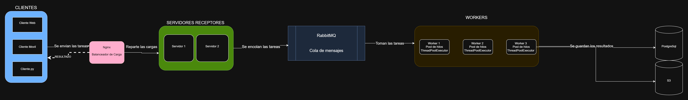

# PFO 3: Rediseño como Sistema Distribuido

### Cliente-Servidor con sockets

**Alumno:** Santiago Agustín Rojas Casas

**Materia:** Programacion sobre Redes

## Cómo ejecutarlo

1. Abrir una terminal y ejecutar el servidor:

       py servidor.py

2. Abrir otra terminal (o varias, para probar varios clientes) y ejecutar:

       py cliente.py

3. Escribir un mensaje y presionar Enter. Un mensaje vacío cierra el cliente.

## Requisitos

- Python 3 (solo usa la biblioteca estándar, no hay que instalar nada).

## Arquitectura y alcance

